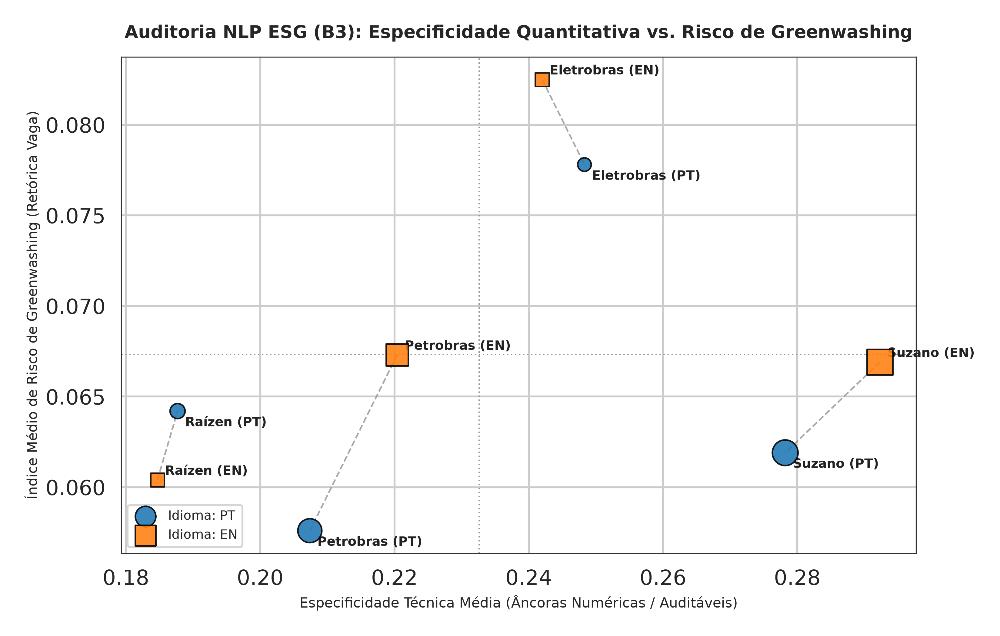
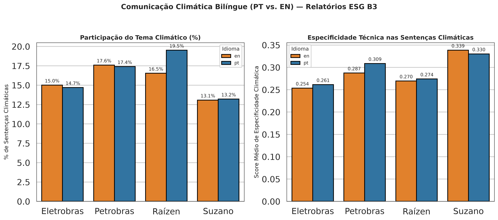
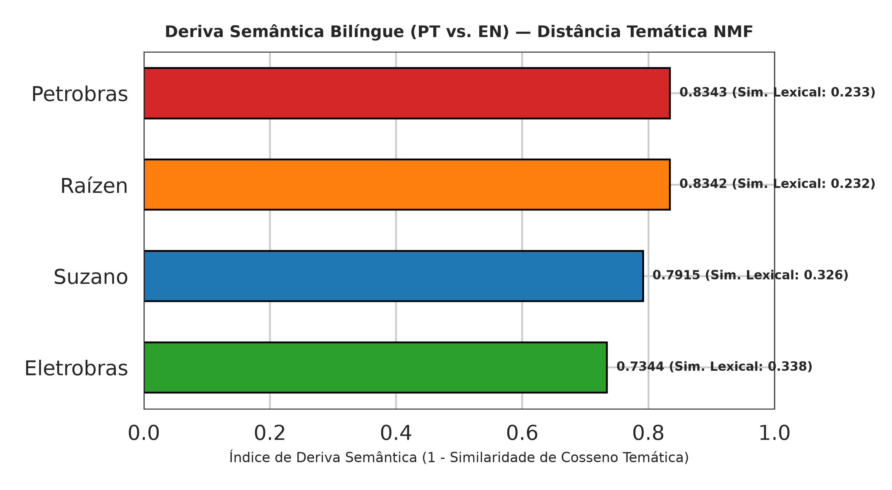

# Auditoria Bilíngue de Greenwashing e Especificidade Técnica em Relatórios ESG (B3)

Pipeline de Processamento de Linguagem Natural (NLP) para auditoria comparativa bilíngue (**Português vs. Inglês**) de relatórios de sustentabilidade e relatos integrados de grandes companhias listadas na B3 (**Eletrobras**, **Petrobras**, **Raízen** e **Suzano**).

O projeto investiga três hipóteses centrais de comunicação corporativa ASG:
1. **Assimetria Bilíngue de Discurso (*Bilingual Framing*):** As empresas alteram o peso temático climático ou o tom aspiracional entre relatórios voltados ao público doméstico (PT) e investidores internacionais (EN)?
2. **Densidade de Especificidade vs. Retórica Vaga (*Cheap Talk*):** Qual a proporção de alegações climáticas e socioambientais ancoradas em metas auditáveis, métricas físicas/financeiras e padrões (GRI, SASB, TCFD, SBTi) versus promessas institucionais genéricas?
3. **Deriva Semântica Bilíngue (*Semantic Drift*):** Quais companhias praticam tradução espelhada fiel e quais produzem recortes editoriais distintos por mercado?

---

## Arquitetura do Pipeline

* `data/raw/` — Relatórios anuais/integrados originais em PDF (PT e EN)
* `data/interim/` — Páginas extraídas e limpas (`corpus_pages.parquet`)
* `data/processed/` — Bases pontuadas (`esg_sentences_scored.parquet`, `esg_sentences_with_topics.parquet`) e tabelas consolidadas (`company_esg_audit_summary.csv`, `top_greenwashing_flags.csv`, `cross_language_topics.csv`, `bilingual_semantic_drift.csv`)
* `reports/figures/` — Gráficos executivos em alta resolução (`300 DPI`)
* `src/01_pdf_extractor.py` — Extração textual e padronização de metadados
* `src/02_nlp_scoring.py` — Filtro de *boilerplate*, léxicos PT/EN e índices de especificidade/greenwashing
* `src/03_topics_and_drift.py` — Modelagem de tópicos NMF *cross-lingual* e deriva semântica
* `src/04_visualizations.py` — Geração dos painéis analíticos comparativos
* `README.md` — Documentação técnica do repositório

---

## Principais Resultados (Corpus Limpo: 23.899 Sentenças)

Após a remoção automatizada de cabeçalhos, rodapés e barras de navegação repetitivas intra-documento (*boilerplate filtering*), a auditoria consolidada por empresa e idioma apresenta o seguinte perfil:

| Empresa | Idioma | Sentenças Válidas | Tema Climático (%) | Especificidade Média | Risco GW Médio | Sentenças Alto Risco GW | Especificidade Climática |
| :--- | :---: | :---: | :---: | :---: | :---: | :---: | :---: |
| **Eletrobras** | EN | 1.439 | 15,01% | 0,2420 | 0,0825 | 170 | 0,2536 |
| **Eletrobras** | PT | 1.381 | 14,70% | 0,2483 | 0,0778 | 148 | 0,2614 |
| **Petrobras** | EN | 3.677 | 17,60% | 0,2204 | 0,0673 | 306 | 0,2875 |
| **Petrobras** | PT | 4.316 | 17,40% | 0,2074 | 0,0576 | 302 | 0,3086 |
| **Raízen** | EN | 1.397 | 16,54% | 0,1847 | 0,0604 | 129 | 0,2696 |
| **Raízen** | PT | 1.706 | 19,52% | 0,1877 | 0,0642 | 157 | 0,2741 |
| **Suzano** | EN | 5.016 | 13,08% | **0,2923** | 0,0669 | 432 | **0,3385** |
| **Suzano** | PT | 4.967 | 13,21% | **0,2782** | 0,0619 | 402 | **0,3302** |

### Achados Analíticos

* **Liderança em Especificidade Técnica e Climática:** A **Suzano** apresenta a maior densidade de âncoras quantitativas e auditáveis tanto no discurso geral (`0,2923 EN` / `0,2782 PT`) quanto no recorte climático (`0,3385 EN` / `0,3302 PT`), seguida pela **Petrobras** no recorte climático (`0,3086 PT` / `0,2875 EN`).
* **Coerência Bilíngue vs. Recorte Editorial:** **Eletrobras** (`deriva = 0,7344`) e **Suzano** (`deriva = 0,7915`) demonstram maior alinhamento lexical e temático entre português e inglês, refletindo tradução espelhada fiel. Já **Petrobras** (`0,8343`) e **Raízen** (`0,8342`) exibem maior deriva semântica devido à publicação de cadernos suplementares e recortes diferenciados para audiências locais e globais.
* **Impacto da Limpeza Estrutural de PDFs:** A filtragem de *boilerplate* intra-documento mostrou-se crítica para eliminar falsos positivos gerados por menus de navegação repetidos em todas as páginas (que continham termos como *"Performance Sustentável"* sem indicadores numéricos associados).

---

## Visualizações Executivas

### 1. Especificidade Quantitativa vs. Risco de Greenwashing

### 2. Enquadramento e Especificidade Climática (PT vs. EN)

### 3. Deriva Semântica Bilíngue (NMF Cross-Lingual)

---

## Como Reproduzir

1. Clone o repositório: `git clone https://github.com/eniocancian/esg-greenwashing-nlp-b3.git && cd esg-greenwashing-nlp-b3`
2. Instale as dependências principais: `pip install pandas numpy pyarrow pymupdf scikit-learn matplotlib seaborn`
3. Execute os scripts em sequência na pasta `src/`:
   * `python src/01_pdf_extractor.py`
   * `python src/02_nlp_scoring.py`
   * `python src/03_topics_and_drift.py`
   * `python src/04_visualizations.py`

---

## Autor

**Ênio Fernando Cancian Júnior**  
Engenheiro Químico (UEM) | Especialista em Engenharia de Segurança do Trabalho (UNIP) | MBA em ESG (IBMEC) | MBA em Data Science, Analytics & AI (USP/Esalq)  
* GitHub: [@eniocancian](https://github.com/eniocancian)